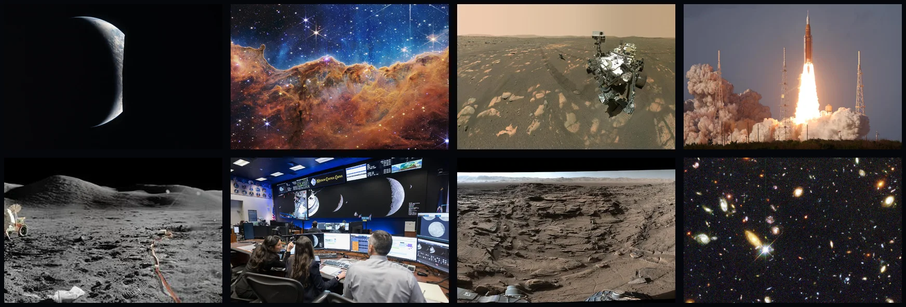

# ORBITAL UI · kit de diseño NASA

Sistema visual frontend para **Outpost Run** (NASA Space Apps 2026): una web con temática NASA que se sienta como una misión espacial y, a la vez, como una fiesta de cumpleaños. Colores de señal, tipografías de misión, parches, bordes HUD, texturas de telemetría y componentes listos para copiar.

Todo el kit es **CSS + SVG + assets locales**. No hay dependencias, ni Google Fonts en runtime, ni frameworks.



---

## Ver la maqueta

```bash
npm run api
# abre http://127.0.0.1:8787/ui-ux/demo/index.html
```

También puedes abrir `ui-ux/demo/index.html` directamente en el navegador (las rutas son relativas). El servidor redirige `/ui-ux/` a la maqueta y ya sirve la carpeta.

La maqueta incluye:

1. **Hero** con parche de misión, órbita, telemetría y la nebulosa de Carina.
2. **Paleta** de 12 colores + 3 gradientes (clic para copiar el hex).
3. **Tipografía**: 8 familias, roles y escala.
4. **Forma y borde**: chaflanes, corchetes HUD, eclipse, foil, parches y stickers.
5. **Componentes**: botones, badges, pestañas, formularios, medidores, tarjetas, tabla y alertas.
6. **Efectos**: starfield, blueprint, scanlines, grano, CRT y foil.
7. **Galería NASA** con atribución visible.

---

## Estructura

```text
ui-ux/
├── css/
│   ├── ui-ux.css          ← punto de entrada (importa todo)
│   ├── fonts.css          ← @font-face locales (generado)
│   ├── tokens.css         ← color, tipo, espacio, radios, sombras, motion
│   ├── base.css           ← reset y accesibilidad bajo .ux-root
│   ├── icons.css          ← íconos Lucide como máscaras (generado)
│   ├── components.css     ← botones, paneles, tarjetas, datos, formularios
│   ├── patterns.css       ← fondos, texturas, efectos y keyframes
│   └── utilities.css      ← helpers con prefijo ux-
├── assets/
│   ├── fonts/             ← 36 woff2 (latin + latin-ext)
│   ├── icons/             ← 52 SVG Lucide (ISC)
│   ├── img/               ← 8 fotos NASA en JPG + WebP + credits.json
│   └── svg/               ← wordmark, parche, órbita, sticker, planeta
├── demo/
│   ├── index.html         ← maqueta tipo landing / kitchen sink
│   └── demo.js            ← reloj UTC, pestañas, copiar hex, slider
├── research/
│   ├── fuentes.md         ← investigación y decisiones de diseño
│   ├── paleta.json        ← tokens legibles por máquina
│   ├── moodboard-nasa.webp
│   └── nasa-graphics-standards-manual-1976.pdf
├── scripts/
│   └── download-assets.mjs
├── LICENSES.md
└── LICENSE
```

---

## Cómo aplicarlo a una web

### 1. Enlaza el CSS

```html
<link rel="stylesheet" href="/ui-ux/css/ui-ux.css">
```

### 2. Marca la raíz

```html
<body class="ux-root">
  ...
</body>
```

El reset está **scoped** a `.ux-root`: puedes importar el kit en la web actual sin que se rompan los estilos existentes. Todos los componentes usan el prefijo `ux-`.

### 3. Usa tokens, no valores sueltos

```css
.hero {
  background: var(--ux-grad-space);
  color: var(--ux-text);
  border: var(--ux-border-hairline);
  border-radius: var(--ux-radius-lg);
  box-shadow: var(--ux-glow-cyan);
}
```

### 4. Ejemplo mínimo de pantalla

```html
<section class="ux-section ux-starfield ux-noise">
  <div class="ux-container">
    <p class="ux-kicker">Outpost Run · Sol 014</p>
    <h1 class="ux-display">Tu base<br><span class="ux-gradient-text">en Marte</span></h1>
    <p class="ux-lead">Cada sol cuenta. Cada decisión tiene un costo.</p>

    <div class="ux-cluster">
      <button class="ux-btn ux-btn--primary">
        <span class="ux-icon ux-icon--rocket" aria-hidden="true"></span>
        Lanzar misión
      </button>
      <button class="ux-btn ux-btn--hazard">Tormenta solar</button>
    </div>

    <div class="ux-panel ux-hud ux-panel--chamfer" style="margin-top:2rem;padding:1.5rem">
      <div class="ux-meter ux-meter--energy ux-meter--lg">
        <div class="ux-meter__head">
          <span class="ux-meter__label">Energía</span>
          <span class="ux-meter__value">82 / 100</span>
        </div>
        <div class="ux-meter__track">
          <div class="ux-meter__fill" style="--ux-value:82%"></div>
        </div>
      </div>
    </div>
  </div>
</section>
```

---

## Fundamentos

### Color

| Token | Hex | Uso |
|---|---|---|
| `--ux-red-500` | `#FC3D21` | Acción, peligro, energía. El rojo del emblema NASA |
| `--ux-blue-600` | `#0B3D91` | Azul institucional, fondos profundos |
| `--ux-blue-500` | `#1C67E3` | Links e interacción |
| `--ux-cyan-400` | `#38BDF8` | Datos, telemetría, foco |
| `--ux-amber-400` | `#F5A524` | Avisos, clima solar |
| `--ux-mint-400` | `#2DD4A7` | Estados nominales / éxito |
| `--ux-rust-500` | `#C1440E` | Marte |
| `--ux-gold-400` | `#D9A441` | Foil de parche |
| `--ux-void` | `#04060C` | Fondo de vacío |
| `--ux-lunar-300` | `#B4C2D6` | Texto secundario |

Los valores oficiales de referencia (rojo `#FC3D21`, azul `#0B3D91`, worm `#E03C31`) están documentados en [`research/fuentes.md`](research/fuentes.md). **NASA no patrocina este proyecto y el emblema/logotipo no se usa como marca.**

### Tipografía

| Rol | Familia | Dónde |
|---|---|---|
| UI base | **Public Sans** | Botones, párrafos, formularios |
| Lectura | **Inter** | Texto largo, UI alternativa |
| Display | **Michroma** | Títulos, paneles, HUD |
| Editorial | **Instrument Serif** | Frases humanas, pitch, citas |
| Telemetría | **IBM Plex Mono** | Etiquetas, cifras, logs |
| Datos | **DM Mono** | Cifras tabulares |
| HUD | **Chakra Petch** | Alternativa sci-fi |
| Póster | **Bungee** | Stickers, fiesta, cumpleaños |

Todas son OFL y se sirven localmente con subsets `latin` + `latin-ext`. Para cambiar una familia, edita `--ux-font-*` en `css/tokens.css`.

### Formas y bordes

- Chaflán: `.ux-panel--chamfer` (`--ux-chamfer-sm/md/lg`).
- Corchetes HUD: `.ux-hud` (variantes `--red`, `--white`, `--lg`).
- Línea fina: `--ux-border-hairline`.
- Órbita punteada: `--ux-border-orbit`.
- Píldora: `--ux-radius-pill`.
- Parche circular: `.ux-patch` (+ `--spin`).
- Sticker: `.ux-sticker`.
- Hexágono: `clip-path` con `.ux-chamfer` o el ejemplo de la maqueta.

### Efectos

| Clase | Qué hace |
|---|---|
| `.ux-starfield` / `--dense` / `--deep` | Campo de estrellas en gradientes |
| `.ux-grid-bg` / `--blueprint` | Retícula técnica |
| `.ux-noise` | Grano SVG sutil |
| `.ux-scanlines` | Líneas de monitor |
| `.ux-crt` | Barrido vertical animado |
| `.ux-foil` | Gradiente metálico de parche |
| `.ux-glow` | Halo radial (`--red`, `--blue`, `--amber`) |
| `.ux-shine` | Destello al hover |
| `.ux-eclipse` | Disco con corona |
| `.ux-horizon` | Horizonte planetario |
| `.ux-marquee` | Cinta de misión infinita |

Las animaciones respetan `prefers-reduced-motion`.

---

## Componentes

| Familia | Clases principales |
|---|---|
| Layout | `.ux-container`, `.ux-section`, `.ux-grid`, `.ux-stack`, `.ux-cluster`, `.ux-split` |
| Tipografía | `.ux-display`, `.ux-h1…h4`, `.ux-kicker`, `.ux-eyebrow`, `.ux-label`, `.ux-serif`, `.ux-poster`, `.ux-gradient-text` |
| Superficies | `.ux-panel`, `--solid`, `--inset`, `--chamfer`, `--signal`, `--glow`, `--interactive`; `.ux-hud`; `.ux-card`, `.ux-tile` |
| Botones | `.ux-btn`, `--primary`, `--secondary`, `--outline`, `--ghost`, `--hazard`, `--sm`, `--lg`, `--icon`, `--block` |
| Estados | `.ux-badge`, `--red/blue/cyan/amber/ok/signal`, `.ux-chip`, `.ux-kbd`, `.ux-status-dot--live` |
| Navegación | `.ux-nav`, `.ux-brand`, `.ux-tabs`, `.ux-tab`, `.ux-breadcrumb` |
| Formularios | `.ux-field`, `.ux-input`, `.ux-select`, `.ux-textarea`, `.ux-check`, `.ux-switch`, `.ux-range`, `.ux-search` |
| Datos | `.ux-meter`, `.ux-readout`, `.ux-stat`, `.ux-table`, `.ux-data`, `.ux-mono` |
| Feedback | `.ux-alert`, `--success/warning/danger`, `.ux-toast` |
| Adornos | `.ux-divider`, `.ux-patch`, `.ux-sticker`, `.ux-eclipse`, `.ux-orbit-box`, `[data-ux-tip]` |
| Íconos | `.ux-icon ux-icon--rocket` (52 nombres; ver `css/icons.css`) |

---

## Accesibilidad

- Foco visible global con `--ux-focus-ring` (cian).
- Targets de botón de al menos 44 px; versión compacta de 34 px solo para acciones secundarias.
- Contraste AA en texto principal y botones; el texto auxiliar usa `--ux-text-muted` sobre superficies oscuras.
- El color nunca es el único indicador: los estados llevan texto (“NOMINAL”, “ALTO”).
- `prefers-reduced-motion` desactiva animaciones y transiciones.
- Skip link incluido (`.ux-skip-link`).
- Iconos decorativos deben llevar `aria-hidden="true"`; los informativos, texto alternativo.

---

## Assets y regeneración

```bash
# Vuelve a descargar fuentes, íconos y fotos NASA
node ui-ux/scripts/download-assets.mjs

# Genera WebP optimizados (requiere ImageMagick)
cd ui-ux/assets/img
for f in *.jpg; do magick "$f" -resize '1600x1600>' -strip -quality 82 "${f%.jpg}.webp"; done
```

- Fuentes: Google Fonts API → `assets/fonts/*.woff2` + `css/fonts.css`.
- Íconos: Lucide Static 0.545.0 → `assets/icons/*.svg` + `css/icons.css`.
- Fotos: NASA Images API → `assets/img/*.jpg` + `credits.json`.
- Originales: `assets/svg/*.svg` están dibujados para el proyecto.

Créditos completos y licencias: [`LICENSES.md`](LICENSES.md).

---

## Integración con el proyecto

- El servidor local ya expone `/ui-ux/` y redirige `/ui-ux/` a la maqueta.
- La página principal (`public/index.html`) tiene un botón **UI KIT** en la barra superior.
- Si vas a migrar el juego, empieza por `tokens.css` y `components.css`; no copies valores hex sueltos.
- La maqueta usa datos **simulados** de ejemplo. Los datos reales siguen viniendo de la API del juego.

---

## Aviso

NASA y la CSA no patrocinan ni respaldan este proyecto. Las imágenes pertenecen a NASA y se usan según sus guías de medios. El emblema, el sello y el logotipo oficial de NASA **no** forman parte de este kit. Código del kit: MIT. Tipografías: SIL OFL 1.1. Íconos: ISC.
